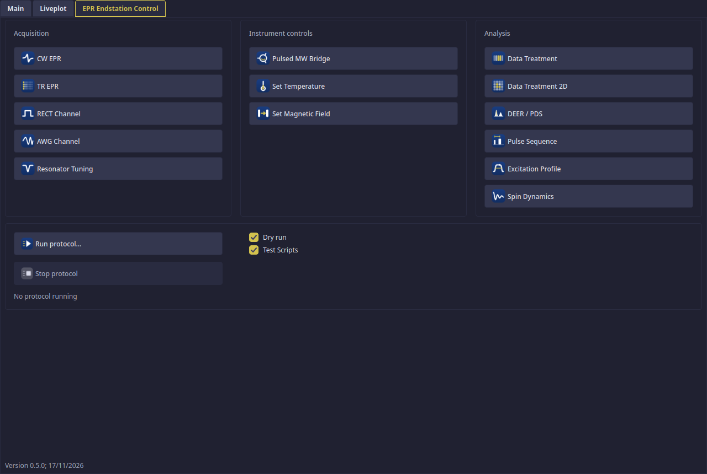
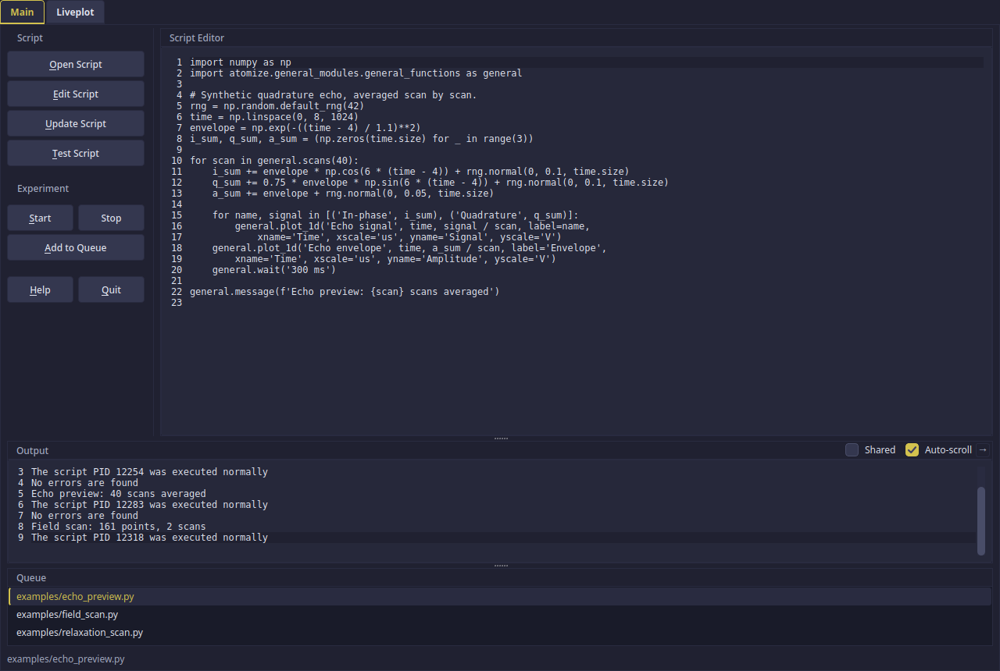
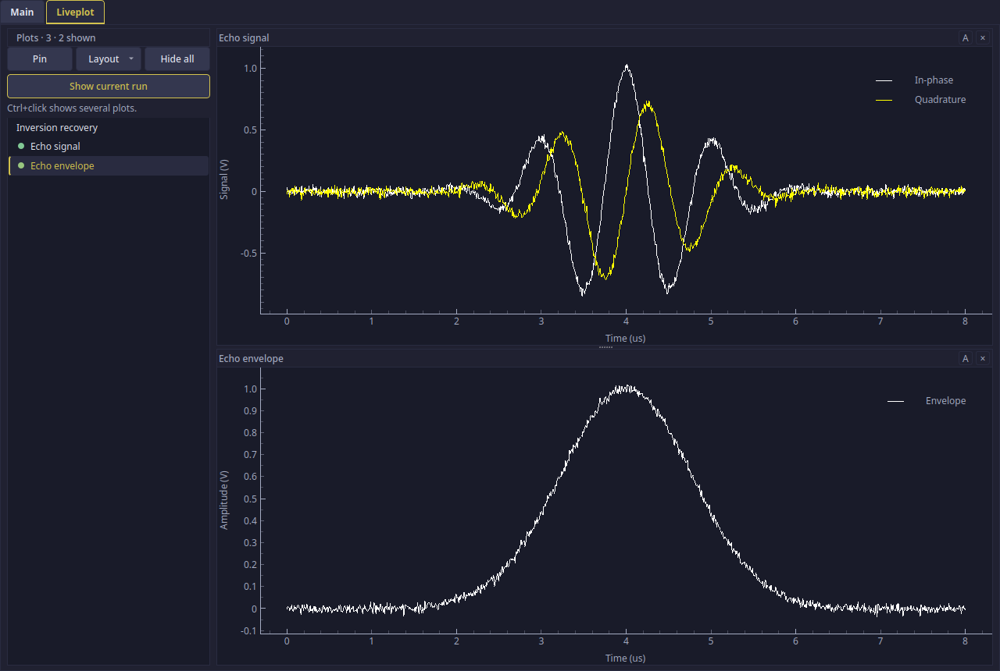

# Usage

## Installation

### From PyPI

The simplest way is to install Atomize from PyPI:

=== "Linux / macOS"

    ```bash
    pip3 install atomize-py
    ```

=== "Windows"

    ```powershell
    pip install atomize-py
    ```

### From source (editable install)

To get the latest version, hack on the code, or write your own instrument
modules, clone the repository and install it in *editable* mode (`-e`), so
that changes to the source take effect without reinstalling:

=== "Linux / macOS"

    ```bash
    git clone https://github.com/Anatoly1010/Atomize.git
    cd Atomize
    pip3 install -e .
    ```

=== "Windows"

    ```powershell
    git clone https://github.com/Anatoly1010/Atomize.git
    cd Atomize
    pip install -e .
    ```

### Optional dependencies (extras)

Some features need extra packages, installed via "extras" in square brackets.
These work with both the PyPI and the source installs (replace `.` with
`atomize-py` for a PyPI install, e.g. `pip3 install atomize-py[math]`):

| Extra    | Command                   | Adds                                                       |
| -------- | ------------------------- | --------------------------------------------------------- |
| `[math]` | `pip3 install -e .[math]` | `scipy` for fitting, signal processing, and DEER analysis |
| `[test]` | `pip3 install -e .[test]` | `pytest` and the test dependencies for running the suite   |

You can combine extras: `pip3 install -e .[math,test]`.

!!! note
    On Windows use `pip` instead of `pip3` in the commands above.

### Isolated environment (recommended)

To avoid conflicts with system-wide packages, install Atomize into a virtual
environment:

=== "Linux / macOS"

    ```bash
    python3 -m venv atomize-env
    source atomize-env/bin/activate
    pip3 install atomize-py        # or: pip3 install -e . from a source checkout
    ```

=== "Windows"

    ```powershell
    python -m venv atomize-env
    atomize-env\Scripts\activate
    pip install atomize-py         # or: pip install -e . from a source checkout
    ```

The environment must be activated each time before launching Atomize. As an
alternative, [conda](https://docs.conda.io/) can be used to manage the isolated
environment.

### Running

Once installed, run the GUI from the terminal (the same command on Linux,
macOS, and Windows):

```bash
atomize
```

If you installed Atomize into an isolated environment, activate it first (see
[Isolated environment](#isolated-environment-recommended) above).

### Stations

A station holds the files of one spectrometer: its GUI control centers, extra instrument modules, device settings and vendor libraries. It is installed on top of Atomize and joins it under the same `atomize` name, so scripts import station and Atomize modules in the same way. Stations are kept in the [Atomize_stations](https://github.com/Anatoly1010/Atomize_stations) repository, one folder per spectrometer:

| Folder  | Spectrometer                                      | Commands                  |
| ------- | ------------------------------------------------- | ------------------------- |
| `itc/`  | [EPR endstation](projects/endstation.md)          | `atomize-itc`, `epr-auto` |
| `itc2/` | ITC2 CW / TR EPR spectrometer                     | `atomize-itc2`, `epr-auto` |

Install Atomize from source first, then the station folder:

=== "Linux / macOS"

    ```bash
    git clone https://github.com/Anatoly1010/Atomize.git
    git clone https://github.com/Anatoly1010/Atomize_stations.git
    pip3 install -e "Atomize[serial,modbus,math,bots]"
    pip3 install -e Atomize_stations/itc
    atomize-itc
    ```

=== "Windows"

    ```powershell
    git clone https://github.com/Anatoly1010/Atomize.git
    git clone https://github.com/Anatoly1010/Atomize_stations.git
    pip install -e "Atomize[serial,modbus,math,bots]"
    pip install -e Atomize_stations/itc
    atomize-itc
    ```

The station command opens the main window with the station's own tabs; `python3 -m atomize` does the same when a station is installed. A station keeps its settings in its own folder named after its command, e.g. `~/.config/atomize-itc/`, so it does not share them with plain Atomize. A station states the oldest Atomize version it works with and stops at start with a message if the installed one is older; pull and reinstall Atomize in that case.



!!! note
    Install one station per Python environment. Stations use the same module names, so two of them in one environment overwrite each other.

## General Configuration

In the terminal where you launched Atomize, the paths to the configuration files and some other details are displayed as follows:

```ini
SYSTEM = Linux
DATA DIRECTORY = /path/to/experimental/data/to/open/
SCRIPTS DIRECTORY = /path/to/atomize/scripts/
MAIN CONFIG PATH = ~/.config/atomize-py/
DEVICE CONFIG DIRECTORY = ~/.config/atomize-py/device_config/
EDITOR = text editor used for editing scripts
```

The `MAIN CONFIG PATH` shows a path to a general configuration file with the name `main_config.ini`. It should be changed at will according to the description below:

```ini
[DEFAULT]
# configure the text editor that will opened when the
# Edit button is pressed.
# "EDITOR":
editor  = subl                              ; Linux
editorW = /path/to/text_editor/on/Windows/  ; Windows

# configure the directory that will opened when Open 1D Data
# or Open 2D Data feature is used in the Liveplot tab.
# "DATA DIRECTORY":
open_dir = /path/to/experimental/data/to/open/

# configure the directory that will be opened when the
# Open Script button is pressed:
# "SCRIPTS DIRECTORY":
script_dir = /path/to/atomize/scripts/

# configure Telegram bot
telegram_bot_token =
message_id =
```

## Instrument Modules

To communicate with a device one should:

- modify the config file located in `DEVICE CONFIG DIRECTORY` of the desired device accordingly. Choose the desired protocol (rs-232, gpib, ethernet, etc.) and correct the settings of the specified protocol in accordance with device settings. A little bit more detailed information about protocol settings can be found [here](protocol_settings.md).
- import the module or modules in your script and initialize the appropriate class. A class always has the same name as the module file. Initialization connect the desired device, if the settings are correct. For more detailed information, see [documentation](functions/digitizer.md).

```python
# importing of the instruments
import atomize.device_modules.Keysight_3000_Xseries as keys
import atomize.device_modules.Lakeshore331 as tc

# initialization of the instruments
dsox3034t    = keys.Keysight_3000_Xseries()
lakeshore331 = tc.Lakeshore331()

# using the instruments
name_oscilloscope = dsox3034t.oscilloscope_name()
temperature       = lakeshore331.tc_temperature('CH A')
```

The same idea is valid for plotting and file handling modules.

```python
# importing of the general purpose modules
import atomize.general_modules.general_functions as general
import atomize.general_modules.csv_opener_saver as openfile

# initialization
file_handler  = openfile.Saver_Opener()
file_data     = file_handler.open_file_dialog()
header, data  = file_handler.open_1d(file_data, header=0)

# using
general.plot_1d('1D Plot', data[0], data[1],
                label='test_data', yname='Y axis', yscale='V')
```

## Experimental Scripts

Python is used to write an experimental script. Examples can be found in the `SCRIPTS DIRECTORY`.

## Workspace

The Main tab contains the Script Editor, Output and Queue panels. Use the script actions to open, edit and test a script, then **Start** to run it. **Stop** interrupts the current experiment and clears the queue. **Add to Queue** schedules scripts to run in sequence. The running script appears at the top of the Queue panel, marked **Running**, even when it was started with an empty queue.



The Liveplot tab displays live plots and lists them in the Plots panel. Long names in Queue and Plots are shortened in the middle; hover over an entry to see the full path or name. Right-click a list or plot to access its available actions.



### Output panel

Output shows script messages and errors. By default, it sits below the Script Editor on the Main tab. Check **Shared** in its header to keep the same output visible on every tab, including Liveplot and any control-center tab. Uncheck **Shared** to return it to Main.

Click the arrow button in the Output header to switch between bottom and right placement. The arrow points toward the next position. Drag the divider to adjust the panel size. The **Shared** setting, placement, and divider sizes are remembered between sessions.

**Auto-scroll** keeps the latest message visible, including when you move or resize Output. Scroll up to pause it and read older messages; your reading position is preserved as new messages arrive or the panel moves. Scroll back to the bottom, press `Ctrl + End` while Output has focus, or check **Auto-scroll** to follow the latest messages again. **Auto-scroll** starts enabled each time Atomize opens.

## Additional Interactivity

The Output dock has the following additional features, available via its right-click menu:

- clear all text from the dock;
- open the local directory with the device configuration files;
- print in the terminal all available instruments connected to your computer using pyvisa.

Keyboard shortcuts for the buttons on the Main tab — format `Alt + key`:

| Shortcut | Button |
| --- | --- |
| `Alt + O` | Open Script |
| `Alt + E` | Edit Script |
| `Alt + U` | Update Script |
| `Alt + T` | Test Script |
| `Alt + S` | Start |
| `Alt + A` | Add to Queue |
| `Alt + H` | Help |
| `Alt + Q` | Quit |

Use Tab / Shift+Tab to move between actions and Space to activate the focused button, including Stop.

The Script Editor dock has the following shortcuts:

| Shortcut   | Action                                                     |
| ---------- | ---------------------------------------------------------- |
| `Ctrl + G` | jump to specified line                                     |
| `Ctrl + F` | search for the specified text                              |
| `Ctrl + N` | show the next occurrence                                   |
| —          | hidden characters can be displayed by selecting any text   |

Use **Add to Queue** to schedule the open script. Scripts added with this button are [tested](writing_modules.md#test-run) before being added. Execution proceeds from top to bottom.

Once a script starts successfully, it appears at the top of the Queue dock, marked **Running**, including when the queue was empty. Opening another script does not change this entry. You can add more scripts while it runs; they are appended below it. When the running script finishes, its entry is removed and the next waiting script starts automatically.

Drag waiting entries to change their execution order. The running entry stays first and cannot be moved or removed. The Queue dock's right-click menu provides:

- **Remove from Queue**: remove the selected waiting entry;
- **Remove All**: remove all waiting entries, keeping the running script and its entry.

Press **Stop** to interrupt the running script and clear the entire queue.

!!! note
    In the ITC station, **Start** also checks whether the Insys FPGA is in use, including by a RECT/AWG preview or experiment. This check applies when script tests are disabled or a previous test result is reused. A blocked launch leaves waiting scripts in the queue. Press **Start** again after the active acquisition finishes.

!!! warning
    In the ITC station, if the acquisition process terminates without releasing the FPGA, the computer must be rebooted before another acquisition. See [`pulser_close()`](functions/pulse_programmer.md#pulser_close) for recovery requirements.

The Liveplot tab has the following additional features in the Plots list (available via right-click menu):

- delete a selected dock with graphs;
- open 1d data in csv multi-column format and plot it in a new graph dock;
- open 2d data in csv format and plot it in a new graph dock.

A **green dot** beside a plot means it is receiving data. After 10 seconds without an update, the dot turns **grey** while the source remains connected; new data turns it green again. The dot remains visible when the plot is hidden and disappears when the source disconnects. Hover over a plot name to see its connection status, the time of its last data update and the names of its curves. An idle connected plot shows **Source connected, idle since HH:MM:SS**. The tooltip lists up to 10 curve names and counts the rest, shows **No curves** for an empty 1D plot and **2D image** for a 2D plot.

Click **Show current run** to restore all connected plots (green or grey dots), including any you have hidden, and follow incoming plots from connected sources. Pinned plots stay visible next to them. The button is highlighted while this complete live view is active. Browsing a plot without a dot or hiding a live plot removes the highlight. The button is disabled when there are no connected plots.

Click a plot in the Plots list to show it together with any pinned plots. **Ctrl**+click adds a plot to the view or removes it, so several plots can be shown at once. During a run, **Ctrl**+click on a plot without a dot keeps the run's plots on screen and adds that plot.

Use **Pin** to keep the selected plots visible while browsing other plots and across new experiments. Select several plots with **Ctrl**+click to pin them together. Pinned plots appear in bold in the Plots list. When all selected plots are pinned, the button reads **Unpin** and releases them. The button is disabled when no plot is selected.

**Hide all** hides every shown plot, including plots in separate windows. The plots remain in the Plots list: click one to show it again, or click **Show current run**. The plots of a new experiment appear when its data arrives.

The **Layout** menu sets how the shown plots are arranged. The active choice is ticked and remembered after a restart:

- **Free** keeps the arrangement made by hand: new plots appear at the bottom, and plots already on screen keep their places and sizes;
- **Rows** places each plot in its own row, **Columns** places all plots side by side;
- **2 per row** and **3 per row** fill rows of two or three plots; beyond four or nine plots, the extra plots become tabs.

With any choice other than **Free**, the shown plots are rearranged whenever a plot appears, is hidden or is added to the view, and sizes set by hand are reset. Plots moved to a separate window (double-click the plot header) stay there; choosing a layout from the menu brings them back.

!!! note
    To keep an arrangement made by hand across experiments, choose **Free**, arrange the plots, select them with **Ctrl**+click and click **Pin**.

When a new experiment starts, its live plots appear together automatically next to the pinned plots. If several plots are selected, the view is kept and the new plots are added to it. Plots from finished runs leave the workspace but remain available in the Plots list. When an experiment finishes, its dots disappear, but the displayed plots remain on screen until you change the view or start a new experiment.

The buttons in each plot header control its view:

| Button | Action |
| --- | --- |
| **× (Hide plot)** | Hides the plot without deleting its data. Hidden live plots continue receiving updates. Click the plot name in the Plots list to reopen it, or use **Show current run** to restore all connected plots (green or grey dots) together. |
| **A (Auto range)** | Fits the axes to the plotted data after zooming or panning. Available on both 1D and 2D plots. |

For 2D image plots, the graph right-click **Colormap** menu selects the colour map and
levelling — **Default** (standard auto-levels) or the opt-in **Auto** / **Bipolar** /
**Sequential** modes, with *Center bipolar on baseline* (neutral white on a non-zero
baseline) and *Per-frame auto-levels* for multi-frame stacks. See
[Colormap and levels](functions/plotting_functions/usage.md#colormap) for details.

The graph docks have the following additional features:

| Feature           | Action                                                                                                                                                                                                                                                                                                                                                                                                          |
| ----------------- | --------------------------------------------------------------------------------------------------------------------------------------------------------------------------------------------------------------------------------------------------------------------------------------------------------------------------------------------------------------------------------------------------------------- |
| **Delete**        | Middle-click a curve name in the legend to remove it from the graph                                                                                                                                                                                                                                                                                                                                             |
| **Bring to Front** | Left-click a curve name in the legend to move it to the top layer                                                                                                                                                                                                                                                                                                                                              |
| **Shift**         | Drag a curve with the mouse to shift it vertically or horizontally                                                                                                                                                                                                                                                                                                                                              |
| **Scale**         | Hold `Ctrl` while dragging a curve to scale it vertically                                                                                                                                                                                                                                                                                                                                                       |
| **Reset**         | `Alt` + Left-click on a curve to reset its shift and scale to their original values                                                                                                                                                                                                                                                                                                                             |
| **Toggle Widgets** | Double-click to show/hide the cross-hair widget (for 1D plots) or the cross-section widget (for 2D plots)                                                                                                                                                                                                                                                                                                      |
| **Lock Position** | Middle-click to lock the cross-hair or cross-section widget in its current position                                                                                                                                                                                                                                                                                                                             |
| **Ruler**         | Hold `Shift` and left-drag to measure distance between two points. For 1D plots the endpoints snap to the nearest data point of the curve under the press position, and the ruler adopts that curve's color; the label shows ΔX, ΔY, and the (X, Y) of both endpoints. For 2D plots the endpoints snap to the nearest pixel center, and the label shows ΔX, ΔY, ΔZ, and the (X, Y, Z) of both endpoints. Hold `Shift + Ctrl` while dragging to use free coordinates without snapping. The ruler stays on screen independently of the cross-hair / cross-section widget — toggling that widget off leaves the ruler in place. To remove it, press `Shift` once more without dragging, or use *Clear Ruler*; it is also dropped automatically when the axes are transformed (FFT / log / derivative) or a new dataset is plotted. |

Additional features available via right-click menu in the graph dock area:

| Feature          | Action                                                                                            |
| ---------------- | ------------------------------------------------------------------------------------------------- |
| **Import Data**  | Open 1D data in multi-column CSV format and plot it directly in the graph dock                    |
| **Export Data**  | Save 2D data from the displayed contour plot                                                      |
| **Hide Label**   | Toggle the visibility of labels on the cross-hair or cross-section widgets                        |
| **Clear Ruler**  | Removes the current ruler overlay from the 1D or 2D plot                                          |
